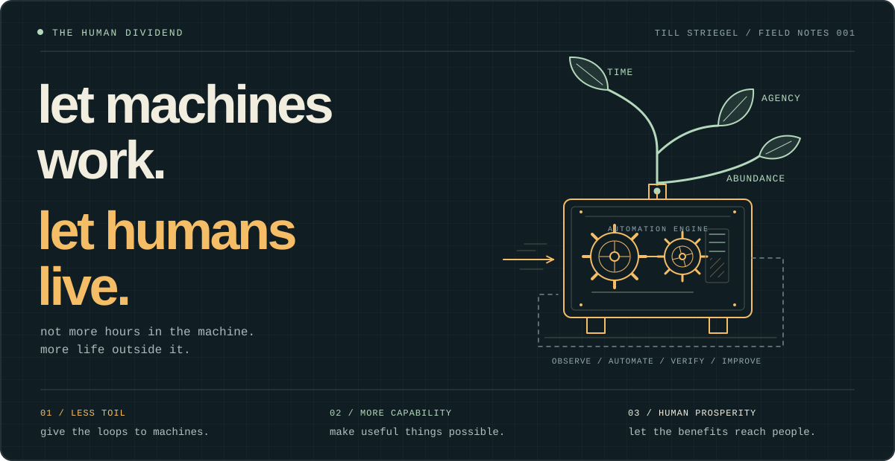

  

<h1 align="center">till striegel</h1>

  AI &amp; Automation Engineer 
  <a href="https://tillstriegel.de">website</a> · <a href="https://github.com/tillstriegel?tab=repositories">repositories</a>

---

i build AI agents and command-line tools to get repetitive work out of the way.

### projects

- [borealis coder](https://github.com/tillstriegel/borealis-coder): an AI coding agent that works with different model providers and saves sessions so you can resume work later.
- [openrouter cli](https://github.com/tillstriegel/openrouter-cli): browse models, check usage, and preview API requests from the terminal.
- [promptbuilder](https://github.com/tillstriegel/promptbuilder-web): assemble prompts with your files and send them to models through OpenRouter.
